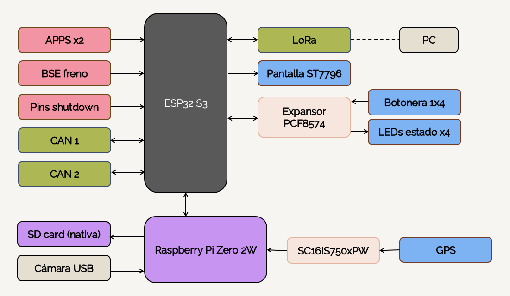

ECU diseño 23 de Octubre de 2026

Los pines del ESP32 S3 no son suficientes y se deriva el GPS al Raspberry pi zero 2w, con preocupaciones de que el procesador no pueda manejar la captura de video y el GPS. Ademas es contraproducente tener el LoRa separado de la micro SD y el GPS. Se discutio buscar un modelo de Raspberry con mayores capacidades y derivar toda la parte de interfaz y comunicacion al mismo (Pantalla, botonera, buzzer, GPS, LoRa). 

Cambiar a un STM32 fue recibido con rechazo por la complejidad que supone programar en uno, y cambiar el modelo de ESP32 supone reescribir mucho codigo ya realizado. Otra posibilidad como ultimo recurso es deshacerse del GPS.
Se espera definir una solucion en la proxima semana.

Diagrama del sistema hasta la fecha:
